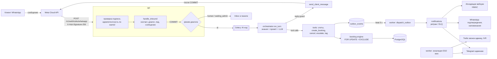

# Архитектура AI CRM (v1.0)

## 1. Компоненты

| Компонент | Технология | Роль | Масштабирование |
|---|---|---|---|
| `caddy` | Caddy 2 | TLS (Let's Encrypt), `api.<домен>` → api, `app.<домен>` → frontend, блокирует `/metrics` снаружи | 1 экземпляр (stateless, сертификаты в томе `caddy_data`) |
| `api` | FastAPI, uvicorn (`backend/app/main.py`) | REST `/v1/*`, вебхуки WhatsApp/Telegram/Twilio, `/health`, `/metrics`, OpenAPI `/docs` | stateless, горизонтально (реплики) |
| `worker` | Celery (`app/workers/tasks.py`) | outbox → уведомления, ретраи/DLQ, AI-ходы в live-режиме, эскалации, напоминания | горизонтально (`--concurrency`, реплики) |
| `beat` | Celery beat (`app/workers/celery_app.py`) | расписание: outbox 5 с, уведомления 15 с, эскалации 30 с, удержания 30 с, сводка, retention | **строго 1 экземпляр** |
| `postgres` | PostgreSQL 16 | единственный источник истины, `EXCLUDE USING gist` против двойных броней | вертикально; реплика для чтения — по необходимости |
| `redis` | Redis 7 | брокер Celery, общие счётчики rate limit | 1 экземпляр (AOF) |
| `frontend` | Next.js 15 | админ-панель RU/KZ (SPA, обращается к `PUBLIC_BASE_URL`) | stateless |
| `backup` | postgres:16-alpine + aws-cli | ежедневный `pg_dump -Fc`, ротация 7/4, шифрование, S3 | 1 экземпляр |

Внешние сервисы (подробно — [THIRD_PARTY.md](THIRD_PARTY.md)): Meta WhatsApp Cloud API, Telegram Bot API, Twilio
Voice, Anthropic Claude, S3-совместимое хранилище, подписчики исходящих вебхуков (Zapier и др.).

## 2. Поток данных: от сообщения клиента до уведомлений

1. **Вебхук.** Проверка HMAC (fail closed), лимит тела 1 МБ, rate limit по IP. Повторная доставка того же
   `wamid` — no-op (уникальный `provider_message_id`).
2. **Inbound.** В одной транзакции: контакт (по каналу), диалог, открытый лид, сообщение. Ответ Meta — 200 сразу
   после COMMIT; AI-ход идёт в Celery (в mock-режиме — в процессе API).
3. **AI-ход** (`app/ai/orchestrator.py`). Язык RU/KK, история, опубликованные статьи базы знаний, услуги/филиалы
   арендатора. Модель вызывает только инструменты (`app/ai/tools.py`): идентичность клиента и арендатора берётся
   из диалога, а не из модели. Фразы «вы записаны» без успешного `create_booking` блокируются guard-ом. Каждый
   ход пишется в `ai_runs`. Ошибка провайдера или включённый kill switch → резервное сообщение клиенту + задача
   администратору + диалог переходит к человеку.
4. **Бронирование** (`app/services/booking.py`). `SELECT … FOR UPDATE` строки сотрудника, повторная проверка
   графика, вставка; финальный барьер — ограничения `EXCLUDE USING gist` по интервалу (сотрудник и ресурс).
   `Idempotency-Key` возвращает ту же бронь.
5. **Outbox.** Событие (`booking.created`, `admin_task.created`, …) пишется в той же транзакции, что и
   изменение. Worker раз в 5 с раздаёт события в уведомления; уведомления доставляются с экспоненциальным
   backoff, после исчерпания попыток — `dead` (DLQ, видно в «Интеграции → События»).
6. **Эскалация.** Задача без ACK: T0 Telegram основному → 5 мин повтор основному+резервному → 10 мин звонок
   (Twilio, IVR «нажмите 1») → резервный. ACK из Telegram/IVR/панели останавливает таймеры.

Голосовой канал использует тот же оркестратор и инструменты (пошаговый `<Gather>`/`<Say>` Twilio).

## 3. Модель данных (обзор)

Все бизнес-таблицы содержат `tenant_id`. Схема — `backend/app/models.py`, миграции — `backend/alembic/versions/`
(`0001_initial`, `0002_voice_calls`).

| Область | Таблицы |
|---|---|
| Организация и доступ | `tenants` (настройки JSON), `branches`, `users`, `memberships` (роль, филиалы, флаги эскалации) |
| Каталог и график | `services`, `staff`, `staff_services`, `resources`, `shifts`, `schedule_exceptions`, `shift_requests` |
| Запись и финансы | `bookings`, `booking_items`, `visits`, `payments` (оплаты/возвраты отдельно от броней) |
| CRM и диалоги | `contacts`, `contact_channels`, `contact_notes`, `leads`, `conversations`, `messages` |
| AI | `knowledge_articles` (draft/published/archived), `ai_runs` (аудит каждого хода) |
| Операции | `admin_tasks`, `notifications`, `calls`, `outbox_events`, `integrations` (секреты зашифрованы), `webhook_subscriptions`, `audit_logs`, `counters` |

## 4. Ключевые инварианты и где они обеспечены

| Инвариант | Механизм | Проверка |
|---|---|---|
| Нет двойных броней | блокировка строки сотрудника + `EXCLUDE USING gist` + idempotency key | AT-01, `scripts/load/slot_race.py` (50 параллельных → 1×201) |
| Сообщение клиенту — только после COMMIT | доставка в `after_transaction_end` корневой транзакции; «вы записаны» только после `create_booking` | `test_delivery_after_commit.py`, AT-03 |
| Ничего не теряется | transactional outbox, at-least-once + идемпотентные обработчики, DLQ | AT-02, AT-10, `webhook_burst.py` |
| Изоляция арендаторов | `tenant_id` только из JWT + активного членства; чужие id = 404; RBAC-матрица | AT-11, `test_security_isolation.py` (IDOR-обход всех маршрутов) |
| Выручка = оплаты − возвраты | отдельный реестр `payments` | AT-08, AT-14 |
| AI не действует за пределами инструментов | строгие схемы, проверка владения, sandbox, guard | `test_prompt_injection.py`, `test_ai_tools_security.py` |

## 5. Масштабирование

- **API**: stateless; добавить реплики `api` за Caddy (`reverse_proxy api:8000` балансирует между ними при
  `docker compose up --scale api=N`). Один процесс uvicorn на контейнер (метрики Prometheus — на процесс).
- **Соединения БД**: каждый процесс держит до `DB_POOL_SIZE + DB_MAX_OVERFLOW` (10+20). Сумма по всем api/worker
  должна быть меньше `max_connections` PostgreSQL (в prod-compose 200); при росте — PgBouncer.
- **Worker**: увеличивать `WORKER_CONCURRENCY` или число реплик; задачи идемпотентны (`acks_late`).
- **Beat**: только один экземпляр, иначе периодические задачи удвоятся (обработчики идемпотентны, но нагрузка растёт).
- **Измерено** (docs/LOAD_TEST.md, 1 процесс API): чтение панели 20 VU — p95 391 мс; всплеск 500 вебхуков —
  0 ошибок. Цель ТЗ §21 (p95 ≤ 2 с) выполнена с запасом ×5.
- Узкие места при росте: `ai_runs`/`messages` (растут быстрее всего — партиционирование/архив по дате),
  LLM-латентность (внешняя), лимиты провайдеров (Meta tier, Twilio CPS).
