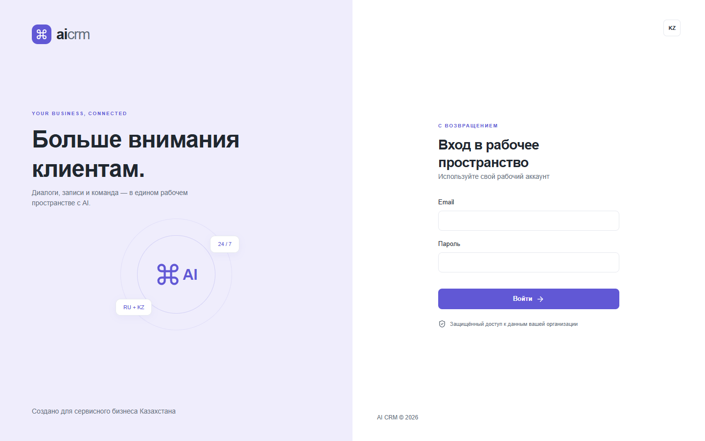
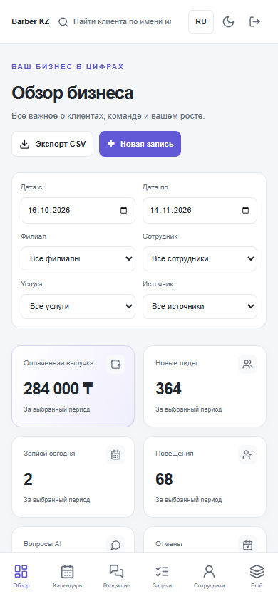

# 1. Начало работы

1. Откройте [панель CRM](http://localhost:3000).
2. Введите рабочие email и пароль, нажмите **Войти**.
3. Проверьте название организации слева: для учебной среды это **Barber KZ**. Если у аккаунта несколько организаций, здесь появится список **Организация**. При одной организации отдельного выбора нет.
4. В верхней панели выберите филиал или **Все филиалы**. Перед созданием записи обязательно проверьте нужный филиал.

Для обучения используются `owner@demo.kz`, `admin@demo.kz`, `barber@demo.kz`, `analyst@demo.kz`; пароль у всех — `demo12345`. Эти аккаунты относятся к демонстрационной среде.

## Язык, тема и выход

- На странице входа кнопка **KZ/RU** переключает язык. Внутри панели кнопка **RU/KZ** находится справа вверху.
- Значок луны/солнца **Сменить тему** переключает светлую и тёмную тему.
- **Выйти** находится рядом с профилем внизу бокового меню; на телефоне — в верхней панели.

## Что доступно каждой роли

| Роль | Основная работа |
| --- | --- |
| Владелец | Все разделы, настройки организации, команда, интеграции, финансы, публикация знаний и экспорт отчётов. |
| Администратор | Обзор, записи, клиенты, лиды, чаты, звонки, задачи, сотрудники, услуги, черновики знаний; просмотр интеграций. Может проводить оплату из записи. Раздел финансов, суммы в отчётах, экспорт отчётов и настройки владельца недоступны. |
| Мастер / сотрудник | Календарь своих записей, разрешённые действия со статусом своей записи, сотрудники и услуги; заявка на изменение графика. Общая клиентская база, чаты, аналитика и настройки недоступны. |
| Аналитик | Просмотр обзора, календаря, клиентов, лидов, сотрудников, услуг, финансов и аналитики; CSV/XLSX отчётов. Изменение записей и работа с чатами недоступны. |

> Меню зависит от роли. Сообщение **Нет доступа** не означает потерю данных: попросите владельца проверить назначенную роль.

## На телефоне

1. Откройте тот же адрес в браузере телефона.
2. Используйте нижнюю навигацию; остальные разделы открываются через **Ещё**.
3. В диалоге кнопка **К диалогам** возвращает к списку. Широкие таблицы прокручивайте горизонтально.

[К содержанию](README.md) · [Далее: обзор](02-dashboard.md)
