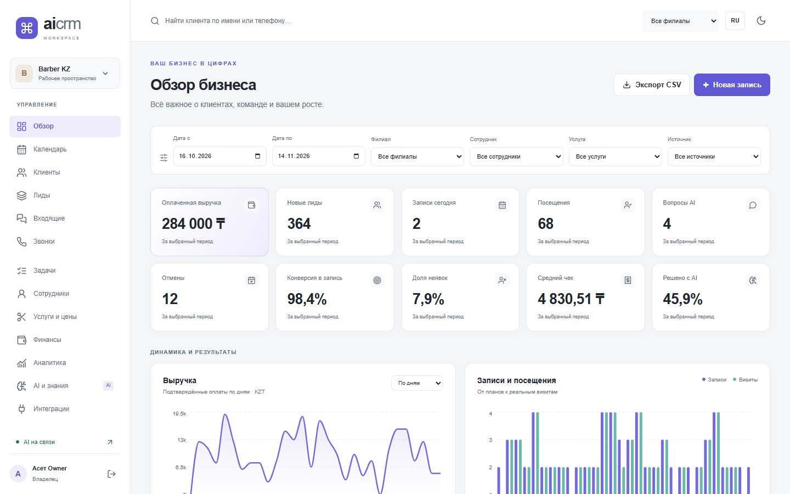

# 2. Обзор бизнеса

1. Откройте **Обзор**.
2. Укажите **Дата с**, **Дата по**, филиал, сотрудника, услугу и источник обращения. Показатели и графики пересчитываются по фильтрам.
3. Сравните записи, посещения, отмены и неявки; затем посмотрите источники обращений и загрузку команды.
4. Для быстрой записи используйте **Новая запись**, если кнопка доступна вашей роли.

> На странице обзора карточка **Записи сегодня** всегда показывает текущий день по часовому поясу филиала. В **Аналитике** эта карточка называется **Записи за период**. **Вопросы AI** — текущие открытые и взятые в работу задачи с учётом филиала; даты, сотрудник, услуга и источник эту карточку не ограничивают. Остальные показатели относятся к выбранному периоду.

## Как читать числа

| Показатель | Простое объяснение |
| --- | --- |
| Оплаченная выручка | Полученные подтверждённые оплаты, предоплаты и корректировки минус подтверждённые возвраты. Оплата учитывается датой получения денег, возврат — своей датой. Это не сумма цен всех записей. |
| Новые лиды | Обращения, созданные за выбранный период. |
| Записи | Записи со временем начала в периоде и статусом «подтверждена», «клиент пришёл», «завершена» или «неявка». Отмены считаются отдельно. |
| Посещения | Записи со статусом «клиент пришёл» или «завершена», а также зарегистрированные визиты без записи. |
| Конверсия в запись | Доля уникальных клиентов с квалифицированным лидом за период, которые дошли до записи, × 100%. Ручная запись без лида сама по себе этот показатель не повышает. |
| Доля неявок / no-show | Число неявок ÷ число записей × 100%. |
| Средний чек | Средняя положительная сумма оплат минус возвраты на одну запись/визит за выбранный период. Полностью возвращённые и нулевые суммы в среднее не входят. |
| Решено с AI | Доля диалогов с запуском AI, в которых не было сообщения человека и задачи администратору. |
| Загрузка сотрудника | Минуты клиентских записей ÷ доступные рабочие минуты с учётом смен, перерывов и исключений × 100%. |

## Графики

- **Выручка**: переключайте группировку по дням, неделям или месяцам. Наведите указатель на точку, чтобы увидеть значение.
- **Записи и посещения**: сравнивайте планы и фактические визиты.
- **Популярные услуги**: рейтинг по оплаченной выручке, а не по прайс-листу.
- **Источники клиентов** и **Воронка лидов**: показывают, откуда пришли обращения и на каких этапах они находятся.
- **Загрузка по часам**: число записей по часу начала; это не процент занятости.
- **Команда в цифрах**: выручка, визиты и процент загрузки каждого сотрудника.
- **Отмены и неявки**: отдельные ряды для двух разных причин потери визита.

> Администратору сервер скрывает денежные показатели. В текущем интерфейсе скрытая сумма может отображаться как **0 ₸**; это не доказательство отсутствия выручки. Для сверки сумм обратитесь к владельцу или аналитику.

[К содержанию](README.md) · [Аналитика и экспорт](10-analytics.md)
