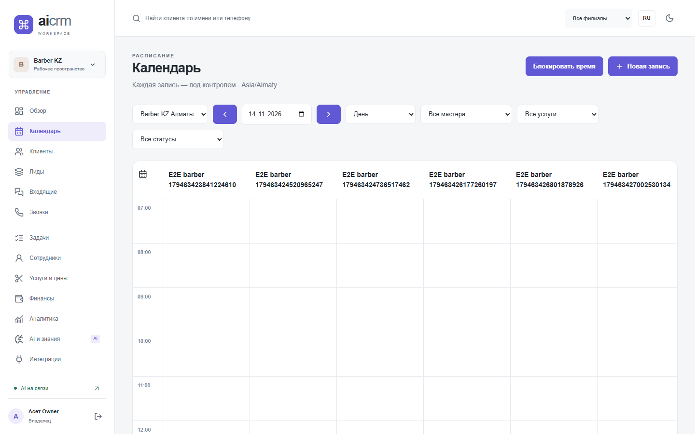
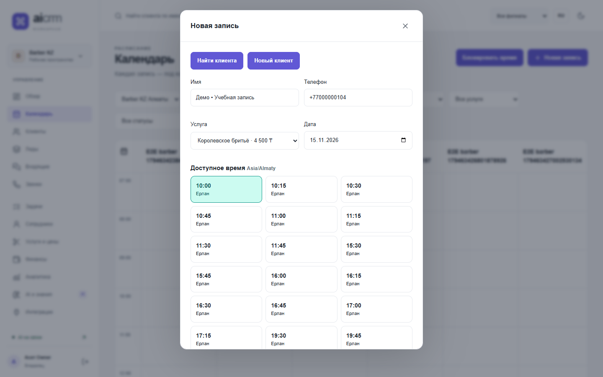
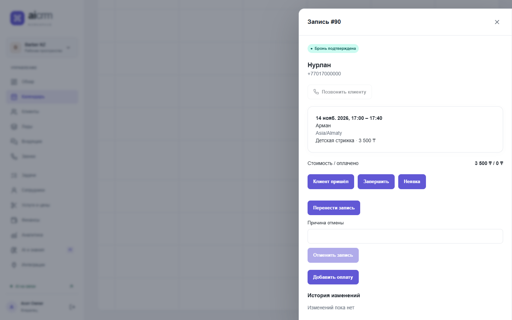
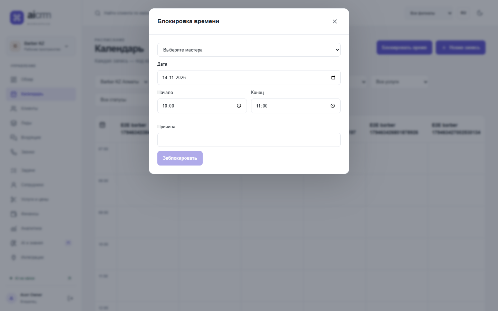
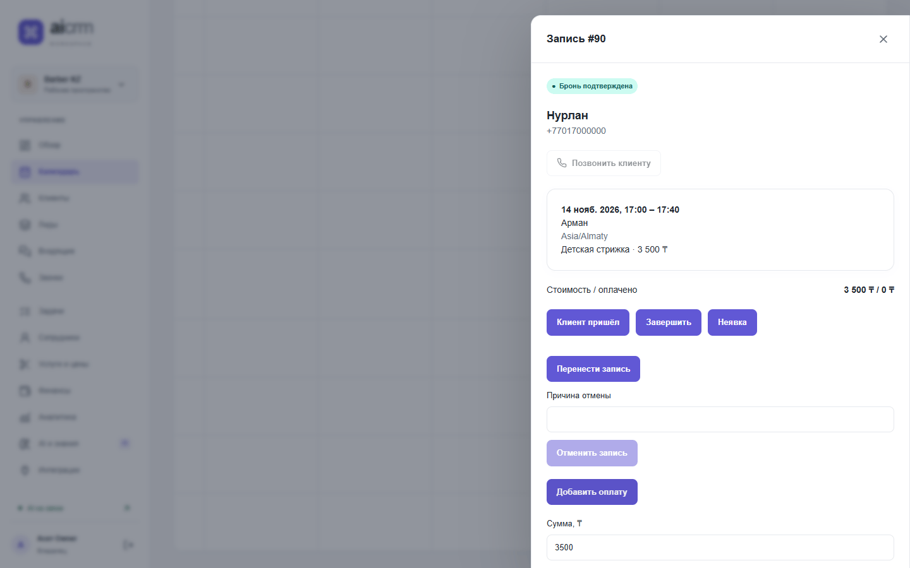

# 03. Календарь и записи

[← Содержание](README.md) · [Клиенты и лиды →](04-clients-leads.md)

## Записать клиента

1. Откройте **Календарь**. Проверьте филиал, дату и часовой пояс рядом с заголовком.
2. Нажмите **Новая запись** или свободную ячейку нужного мастера. Переключатель **День / Неделя** меняет вид расписания; фильтры отбирают мастера, услугу и статус.
3. Нажмите **Найти клиента**, найдите имя или телефон и выберите карточку в списке. Для первого визита нажмите **Новый клиент** и заполните имя и телефон с кодом страны.
4. Выберите услугу, дату и кнопку свободного времени с именем мастера. При необходимости добавьте комментарий.
5. Нажмите **Создать запись**. Дождитесь сообщения об успешном создании и проверьте запись в календаре.

> **Правило:** AI и администратор подтверждают запись клиенту только после её успешного создания в системе. Выбранное время ещё не означает, что запись сохранена.

Если свободного времени нет, выберите другую дату. Если место заняли во время сохранения, форма показывает доступные альтернативы: выберите одну и повторите создание. Мастер может создавать записи только на себя.

## Перенести или отменить

1. Откройте запись. Для согласованного с клиентом переноса нажмите **Перенести запись**, выберите новое время и **Подтвердить перенос**.
2. На компьютере владелец и администратор также могут перетащить запись в другую ячейку и подтвердить перенос. При конфликте система предложит альтернативы.
3. Для отмены заполните **Причина отмены**, нажмите **Отменить запись** и подтвердите действие.

> Перенос доступен для удержания, ожидающей и подтверждённой записи. Завершённую, отменённую запись или неявку перетаскивать нельзя. Отмена записи сама по себе не оформляет возврат оплаты; см. [Финансы](09-services-finance.md).

## Отметить результат визита

В карточке показаны только допустимые действия для текущего статуса:

| Текущий статус | Следующее действие |
| --- | --- |
| Удержание / Ожидает подтверждения | Подтвердить либо отменить |
| Бронь подтверждена | Клиент пришёл, Завершить, Неявка либо отменить |
| Клиент пришёл | Завершить |

Подтверждайте выбранное действие в окне подтверждения. Внизу карточки находится **История изменений**. Мастер меняет статусы только собственных записей; перенос и отмену выполняет администратор или владелец.

## Заблокировать время и принять оплату

- Владелец или администратор: **Блокировать время** → мастер → дата → начало и конец → причина → **Заблокировать**. Исключение можно проверить в разделе [Сотрудники](08-staff.md).
- В карточке записи: **Добавить оплату** → сумма → способ оплаты → **Подтвердить оплату**. Рядом видны стоимость и уже оплаченная сумма. Мастер и аналитик оплату не вводят.

> После блокировки проверьте существующие записи и задачи по конфликтам. Изменение графика не переносит клиентов автоматически.
