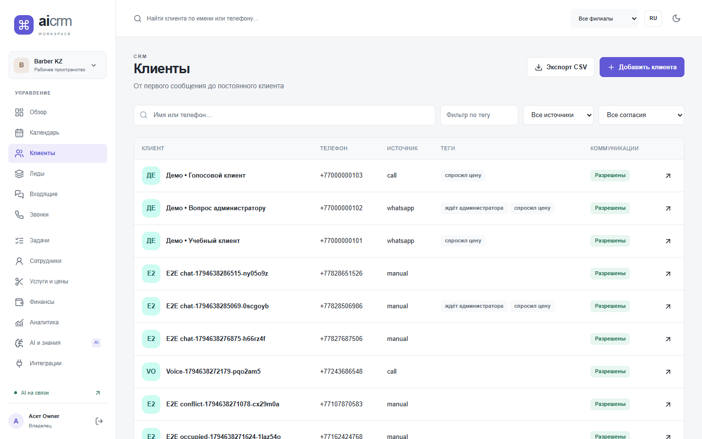
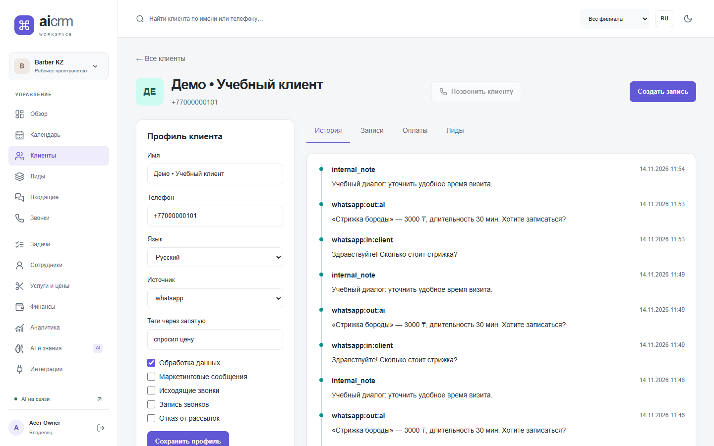
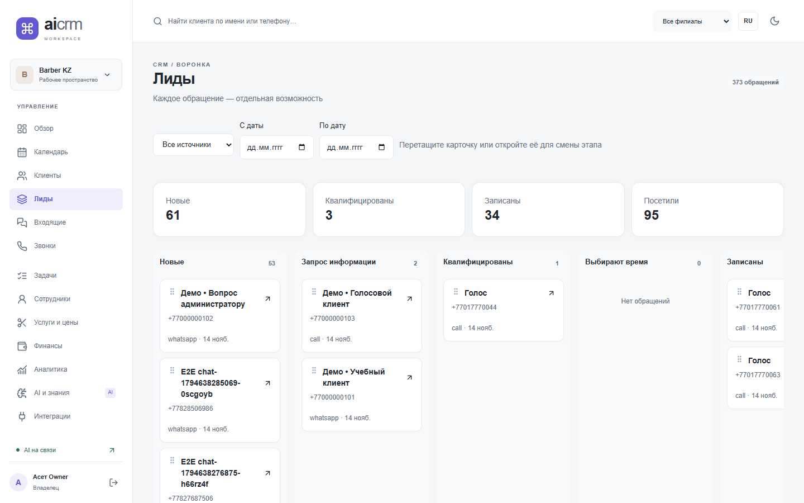

# 04. Клиенты и лиды

[← Содержание](README.md) · [Диалоги и AI →](05-inbox-ai.md)

## Найти или добавить клиента

1. Откройте **Клиенты**. Введите имя или телефон; при необходимости укажите тег, источник и состояние рассылок.
2. Нажмите имя клиента или стрелку справа, чтобы открыть карточку. Кнопки **Назад / Далее** листают список по 25 клиентов.
3. Для новой карточки нажмите **Добавить клиента**, укажите имя и телефон в международном формате, затем **Создать клиента**.

Владелец может выгрузить отфильтрованный список кнопкой **Экспорт CSV**. Аналитик читает карточки, но не изменяет их. У мастера общего списка клиентов нет.

## Обновить карточку и согласия

1. В блоке **Профиль клиента** измените имя, телефон, язык и источник. Теги вводите через запятую.
2. Проверьте отдельные отметки: обработка данных, маркетинговые сообщения, исходящие звонки, запись звонков. При отказе клиента включите **Отказ от рассылок**.
3. Нажмите **Сохранить профиль**. Не меняйте согласия без подтверждённого решения клиента.
4. Откройте вкладки **История**, **Записи**, **Оплаты**, **Лиды**. Чтобы оставить служебную информацию, заполните **Внутренняя заметка** и нажмите **Добавить**.

> Разрешение на рассылки, согласие на исходящий звонок и согласие на запись звонка — отдельные настройки. Проверяйте каждую перед соответствующим действием.

Из карточки можно **Создать запись** или воспользоваться кнопкой звонка при наличии доступа и необходимых согласий; см. [Звонки](07-calls.md).

## Объединить дубликаты

1. Убедитесь, что обе карточки относятся к одному человеку. Сравните телефон и историю.
2. Откройте карточку, которую хотите оставить. В блоке **Объединить дубликат** введите **ID другой карточки**: его можно взять из адреса этой карточки после `/clients/`.
3. Нажмите **Объединить** и подтвердите действие. Проверьте объединённую историю.

> Объединение меняет клиентские данные. Не выбирайте карточку только по совпадающему имени.

## Вести воронку лидов

1. Откройте **Лиды** и отберите источник и даты.
2. Нажмите название карточки или перетащите её в нужный столбец.
3. В окне **Изменить этап** выберите этап и нажмите **Подтвердить изменение**. Для **Потеряны** и **Отменены** обязательно укажите причину.
4. При открытии карточки можно также изменить теги и указать ID ответственного. Стрелка у имени ведёт к клиенту.

Этапы: **Новые → Запрос информации → Квалифицированы → Выбирают время → Записаны → Посетили**; отдельно доступны **Потеряны**, **Отменены**, **Повторные**. Этап описывает состояние обращения.

> Перемещение лида в «Записаны» не заменяет создание записи в календаре. Проверьте реальную запись перед подтверждением клиенту.

Если обращений больше 200, сузьте даты и источник: доска показывает первые 200.
