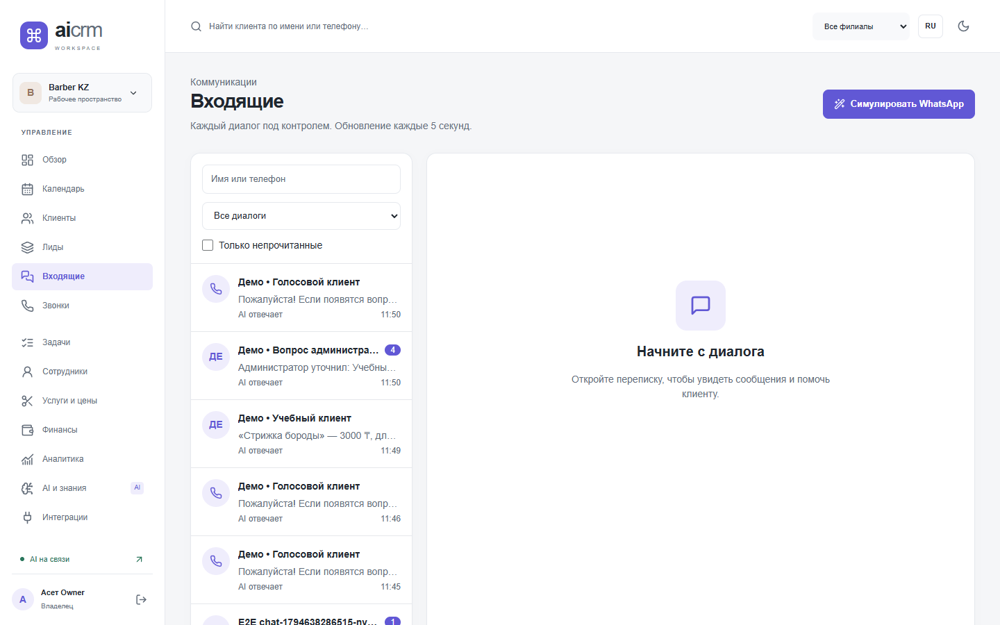
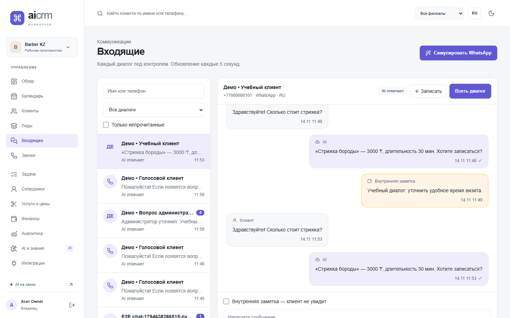
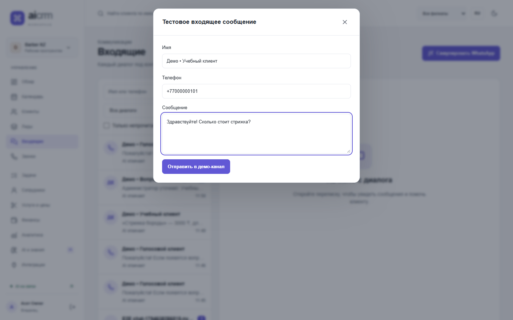

# Входящие и AI-администратор

[← Содержание](README.md)

## Найти переписку

1. Откройте **Входящие**.
2. Найдите клиента по имени или телефону. При необходимости выберите режим диалога или **Только непрочитанные**.
3. Нажмите на диалог: справа появится история. На телефоне список сменяется перепиской; **К диалогам** возвращает к списку.

История обновляется каждые 5 секунд. Подписи различают сообщения клиента, AI, администратора и системы. Ошибка доставки отмечается отдельно; наличие сообщения в истории ещё не означает, что клиент его получил.

## Кто сейчас отвечает

| Индикатор | Действие администратора |
|---|---|
| **AI отвечает** | Проверяйте историю; при необходимости перехватите диалог. |
| **Человек отвечает** | Ответьте сами. Чтобы возобновить автоматические ответы, верните диалог AI. |
| **Ждём админа** | Откройте связанную задачу и дайте проверенный ответ. |

1. Нажмите **Взять диалог** и подтвердите действие.
2. Напишите ответ и нажмите **Отправить**.
3. Когда вопрос решён, нажмите **Вернуть AI** и подтвердите.

Если отправить ответ из режима AI, появится подтверждение **Отправить и взять диалог?**. После отправки отвечать будет человек.

## Оставить заметку для команды

1. Включите **Внутренняя заметка — клиент не увидит**.
2. Введите текст и нажмите **Отправить**.
3. Перед следующим ответом клиенту снимите этот флажок.

> **Важно:** внутренняя заметка остаётся в истории команды и не отправляется клиенту. Обычный ответ переводит диалог в режим человека.

Кнопка **Записать** открывает календарь с выбранным клиентом. Проверьте услугу, мастера и время по [инструкции календаря](03-calendar.md).

> **Правило записи:** AI подтверждает запись только после её успешного создания в системе. Проверяйте запись в календаре; предложение времени в сообщении само по себе бронью не является.

## Обучить сотрудника в демо-канале

1. Нажмите **Симулировать WhatsApp**.
2. Укажите вымышленное имя, тестовый телефон в международном формате и сообщение клиента.
3. Нажмите **Отправить в демо-канал**, затем откройте созданный диалог.

> **Важно:** симулятор создаёт настоящую запись переписки в демо-организации. Используйте вымышленные данные. Для проверки ответа без создания переписки используйте [«Тестировать AI»](11-ai-knowledge.md).

Если AI не отвечает или ошибся, см. [частые вопросы](13-faq.md).
