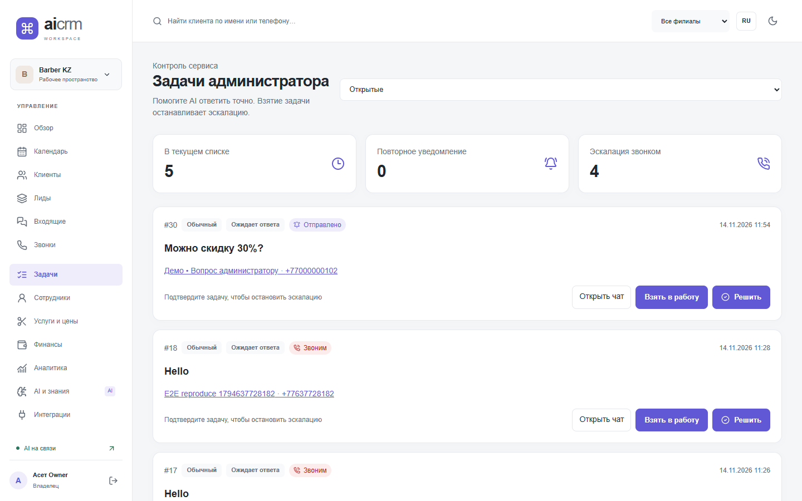
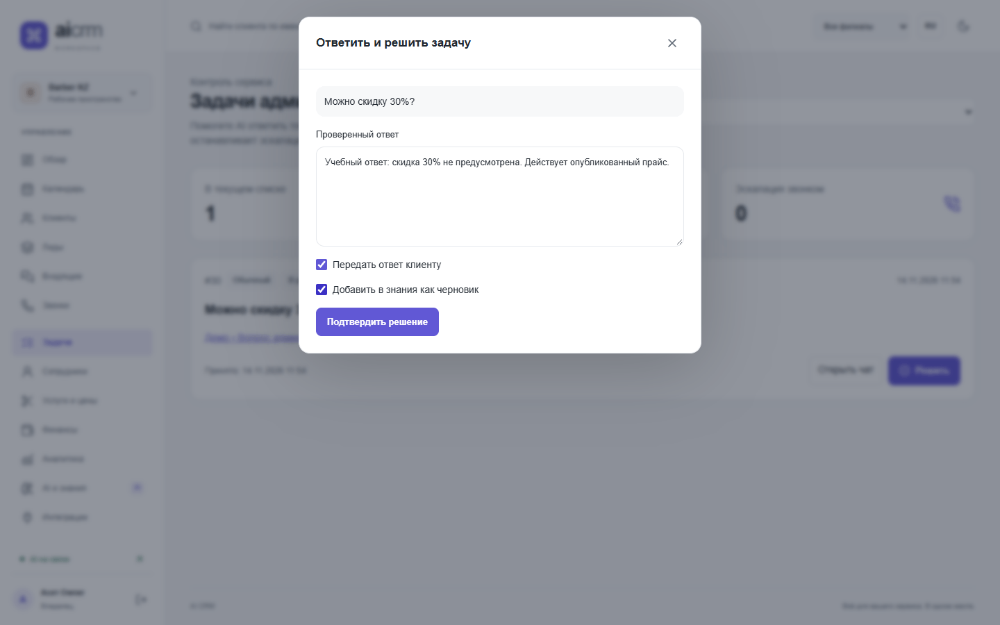

# Задачи администратора и эскалация

[← Содержание](README.md)

## Принять вопрос AI

1. Откройте **Задачи администратора**.
2. В фильтре выберите **Открытые**. Прочитайте вопрос и при необходимости нажмите **Открыть чат**.
3. Нажмите **Взять в работу**. Задача перейдёт в список **В работе**.

> **Важно:** просмотр уведомления или чата не останавливает эскалацию. Её останавливает подтверждённое взятие задачи в работу.

В карточке видны номер, приоритет, статус, время создания и этап уведомления: **Отправлено**, **Повторно** или **Звоним**. Счётчики сверху относятся к текущему списку.

## Ответить клиенту и сохранить знание

1. Нажмите **Решить**.
2. В поле **Проверенный ответ** напишите точную информацию.
3. Оставьте **Передать ответ клиенту**, если ответ нужно отправить в связанную переписку.
4. Если информация пригодится снова, включите **Добавить в знания как черновик**.
5. Нажмите **Подтвердить решение**. Найдите результат через фильтр **Решённые**.

Если задача не связана с перепиской клиента, снимите **Передать ответ клиенту**: отправлять ответ в таком случае некуда. После решения связанный диалог из режима **Ждём админа** возвращается AI; если хотите продолжить отвечать сами, возьмите диалог.

> **Важно:** добавление из задачи создаёт черновик. Для использования в обычных ответах AI владелец должен проверить и [опубликовать статью](11-ai-knowledge.md).

## Telegram и звонок администратору

При настроенном Telegram уведомление содержит кнопки **Взять** и **Ответить**. **Взять** закрепляет задачу и останавливает эскалацию; **Ответить** предлагает отправить текст ответом на сообщение бота. После ответа проверьте результат в CRM.

Стандартная цепочка для вопроса без подтверждения:

1. Сразу — уведомление администратору.
2. Через **5 минут от создания** — повторное уведомление.
3. Через **10 минут от создания** — звонок администратору, если телефония и звонки эскалации включены.

При звонке **нажмите 1**, чтобы взять задачу; **нажмите 2**, чтобы передать её резервному администратору. После взятия откройте CRM или Telegram и дайте ответ: нажатие 1 само по себе вопрос не решает.

> **Условия:** интервалы меняет владелец в настройках. Звонки зависят от подключения телефонии, назначенных основного и резервного сотрудников и тихих часов. Демо-симуляция не подтверждает доставку в настоящий Telegram или на телефон.
