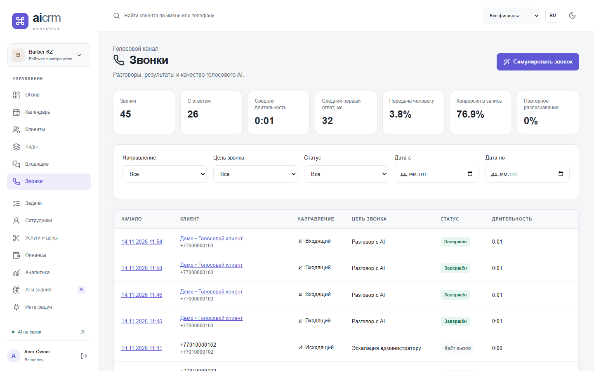
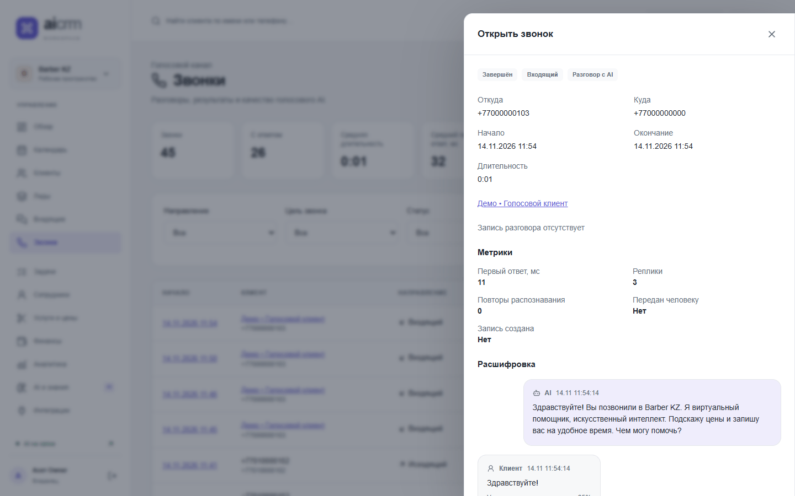
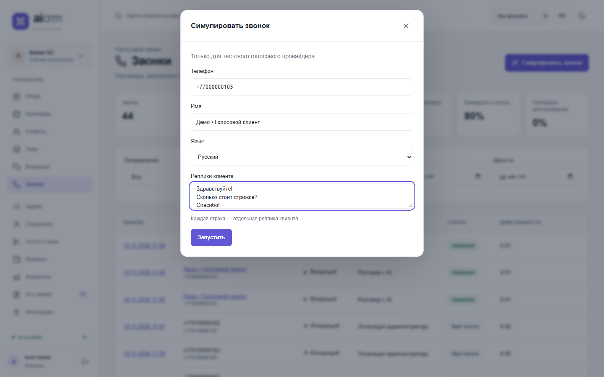

# Звонки и голосовой AI

[← Содержание](README.md)

## Найти звонок и прочитать расшифровку

1. Откройте **Звонки**.
2. Выберите направление, цель, статус и даты. Для сброса нажмите **Сбросить фильтры**, если кнопка отображается.
3. На компьютере нажмите дату звонка; на телефоне — кнопку подробностей в карточке.
4. В открывшейся панели прочитайте статус, длительность, показатели и расшифровку реплик клиента и AI.

Связанные клиент, запись и задача открываются по ссылкам, если они есть и доступны вашей роли. Отметка передачи человеку помогает найти звонки, где потребовалась помощь администратора.

> **Важно:** карточка показывает наличие аудиозаписи. Встроенной кнопки прослушивания в этом экране нет. Расшифровка доступна отдельно от аудиозаписи; при ошибке распознавания уточняйте информацию у клиента.

## Позвонить клиенту

1. В карточке клиента проверьте телефон и согласие **Исходящие звонки**.
2. Нажмите **Позвонить клиенту**.
3. Выберите цель: подтверждение записи, напоминание, обратный звонок или перенос.
4. Проверьте имя и номер и нажмите **Подтвердить звонок**.
5. Нажмите **Открыть звонок**, чтобы следить за результатом.

Без согласия или номера кнопка недоступна. Постановка в очередь ещё не означает, что клиент ответил. Если провайдер не смог начать звонок, откройте подробности и сообщите ответственному за интеграцию.

> **Важно:** отмечайте согласия только после их получения. **Исходящие звонки** и **Запись звонков** — отдельные согласия в профиле клиента. Учитывайте отказ клиента от записи разговора.

Голосовой AI отвечает на входящий звонок и использует данные бизнеса для ответа. Если нужна помощь человека, возможны передача звонка или создание задачи. Реальные звонки требуют подключённой телефонии; работа демо-симулятора не означает, что телефонный канал подключён.

## Проверить голосовой сценарий без реального звонка

В локальной демо-версии доступна симуляция звонка. Укажите тестовый телефон, имя, язык и реплики клиента — каждую с новой строки. Запустите сценарий и откройте расшифровку. Используйте вымышленные данные; симулятор создаёт запись звонка в журнале.

