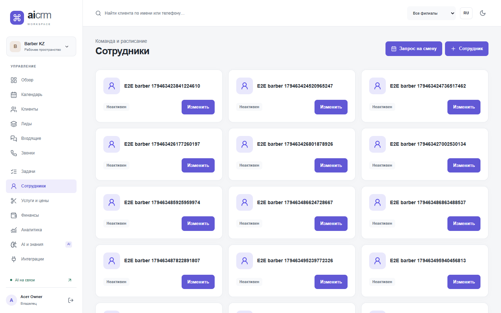
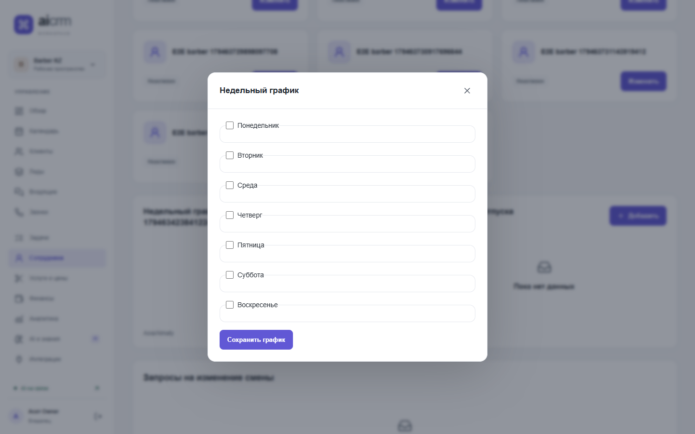
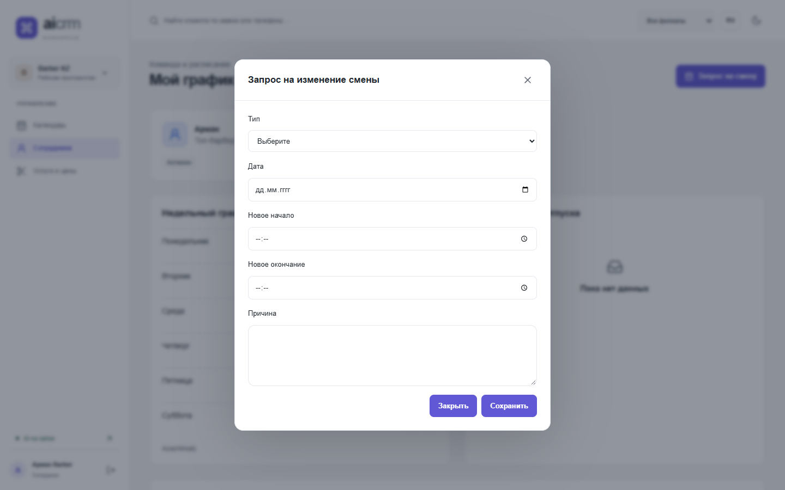

# 08. Сотрудники и графики

[← Содержание](README.md) · [Услуги и финансы →](09-services-finance.md)

## Настроить сотрудника

1. Владелец или администратор открывает **Сотрудники** → **Сотрудник**; для существующей карточки нажимает **Изменить**.
2. Укажите имя, специализацию, филиал, цвет календаря и услуги. Для нескольких услуг удерживайте Ctrl при выборе.
3. Проверьте отметку **Активен** и сохраните профиль.

Выберите карточку сотрудника, чтобы ниже увидеть его недельный график и исключения. Мастер видит **Мой график** и собственные запросы, без редактирования профиля и недельного расписания.

## Задать недельный график

1. В блоке **Недельный график** выбранного сотрудника нажмите **Изменить**.
2. Отметьте рабочие дни, задайте начало и конец каждой смены.
3. При необходимости нажмите **Добавить перерыв** и укажите его начало и конец. Кнопка × удаляет перерыв.
4. Нажмите **Сохранить график**. Конец смены должен быть позже начала; перерывы должны находиться внутри смены.

Время читается в часовом поясе, указанном под расписанием.

## Добавить исключение

1. В блоке **Исключения и отпуска** нажмите **Добавить**.
2. Выберите дату и тип: отпуск, больничный, ранний уход или блокировка.
3. Укажите причину и необходимое время. Для раннего ухода задайте новое окончание работы; для блокировки — начало и конец занятого интервала.
4. Сохраните и проверьте список. Ненужное исключение удаляется отдельной кнопкой с подтверждением.

## Запросить ранний уход и разобрать конфликты

1. Мастер открывает **Мой график** → **Запрос на смену**.
2. Выбирает тип **Ранний уход**, дату, новое окончание и причину; сохраняет запрос. Также доступны отпуск и больничный. Владелец и администратор тоже могут создавать запросы для выбранного сотрудника.
3. Администратор или владелец открывает блок **Запросы на изменение смены** и проверяет **Конфликтующие записи**.
4. Согласуйте изменения с клиентами. Нажмите **Одобрить** или **Отклонить**, обязательно заполните комментарий и сохраните решение.
5. После одобрения проверьте график и задачи, затем вручную перенесите или отмените затронутые записи через [календарь](03-calendar.md).

> **Изменение графика не отменяет и не переносит уже созданные записи автоматически.** При конфликтах система сохраняет записи и создаёт задачу администратору. Одобрение запроса не означает, что клиенты уже предупреждены.
