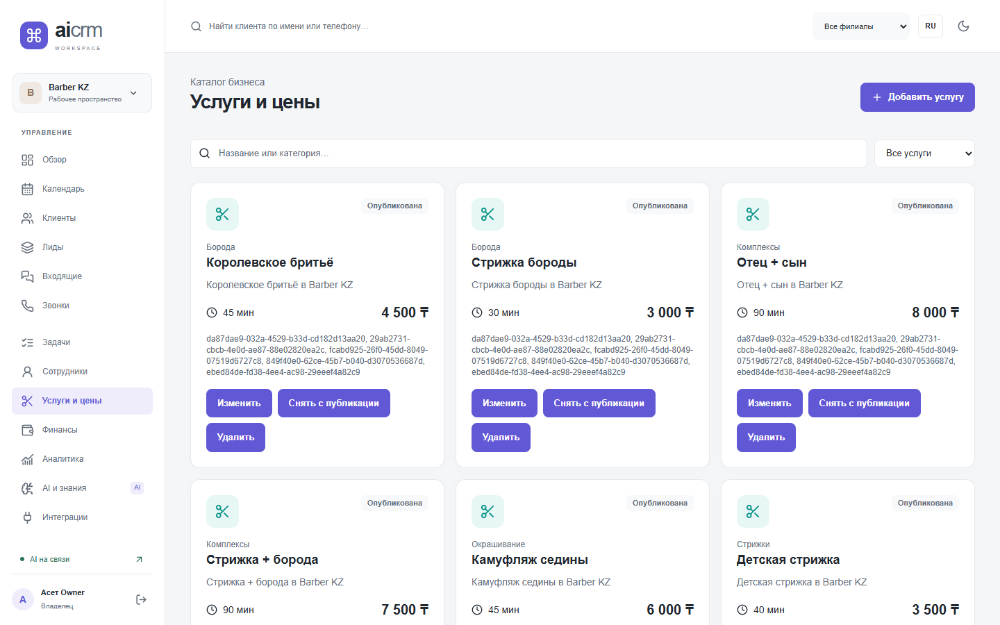
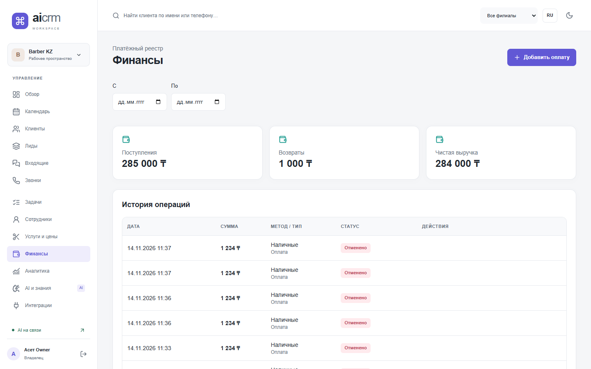
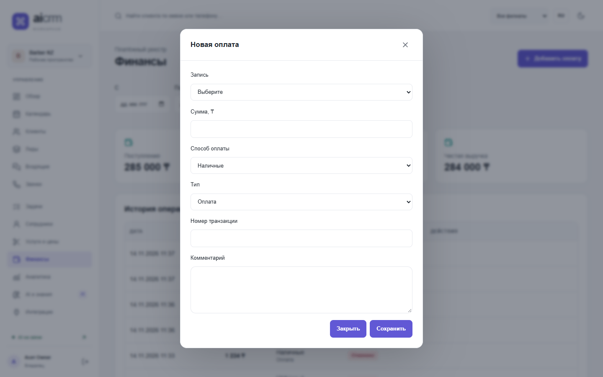
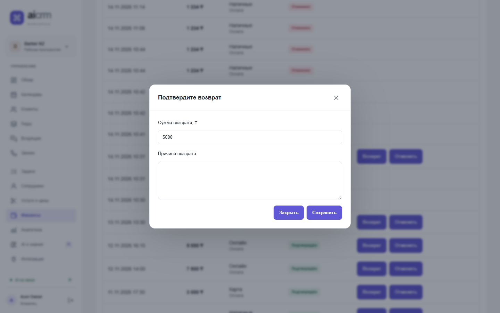

# 09. Услуги, цены и финансы

[← Содержание](README.md) · [Аналитика →](10-analytics.md)

## Создать и опубликовать услугу

1. Владелец или администратор открывает **Услуги и цены** → **Добавить услугу**.
2. Укажите названия **RU** и **KZ**, категорию, описание, длительность и стоимость в тенге.
3. При необходимости задайте буферы до и после услуги. Выберите мастеров, которые её оказывают; для нескольких удерживайте Ctrl. Проверьте отметку **Активна**.
4. Сохраните. Новая услуга появляется как **Черновик**.
5. Проверьте карточку, нажмите **Опубликовать** и подтвердите. Для временного скрытия используйте **Снять с публикации**.

Поиск работает по названию или категории; фильтр **Публикация** показывает все услуги, опубликованные или черновики. В языке KZ отображается казахское название.

> Форма записи предлагает опубликованные услуги. Перед записью проверьте также мастеров, длительность и свободное время. Кнопку **Удалить** используйте только после проверки, что услуга больше не нужна.

## Принять оплату или предоплату

Администратору удобнее открыть запись в [календаре](03-calendar.md): **Добавить оплату** → сумма → способ → **Подтвердить оплату**. В карточке видны стоимость и оплаченная сумма.

Владелец работает также в разделе **Финансы**:

1. Нажмите **Добавить оплату**.
2. При необходимости выберите запись из предложенного списка. Введите сумму, способ и тип **Оплата** или **Предоплата**; можно добавить номер транзакции и комментарий.
3. Сохраните и проверьте операцию в истории.

В форме общего реестра предлагаются завершённые записи. Чтобы привязать оплату к предстоящему визиту, откройте саму запись и используйте оплату из её карточки.

> Ввод операции фиксирует платёж в CRM. Нажимайте подтверждение после фактического получения денег. Изменение статуса визита на «Завершена» само по себе оплату не создаёт.

## Вернуть деньги или отменить ошибочную операцию

Только владелец может оформлять возврат и отменять платёж.

1. В **Финансы → История операций** найдите исходную оплату.
2. Нажмите **Возврат**, укажите сумму и обязательную причину, сохраните. Можно вернуть часть суммы; сумма ограничена ещё не возвращённым остатком.
3. Для ошибочно введённой операции без возвратов используйте **Отменить** и подтвердите действие. Не путайте это с отменой визита.
4. Проверьте историю операций и итоговые показатели.

Аналитик читает реестр; администратор принимает оплату из записи, но полного финансового реестра и возвратов у него нет.

## Найти неоплаченные визиты

1. В разделе **Финансы** прокрутите до **Завершённые без полной оплаты**.
2. Сверьте клиента, номер записи и остаток: **стоимость визита − уже оплачено**.
3. После получения денег нажмите **Оплатить**, введите сумму и сохраните.

Фильтр дат вверху относится к истории операций и финансовым итогам. Список неоплаченных завершённых визитов показан отдельно. При большом количестве данных учитывайте, что экран загружает до 200 операций и до 200 завершённых записей.

Карточки сверху показывают **Поступления**, **Возвраты** и **Чистую выручку**. Чистая выручка — поступления минус возвраты; отменённые операции в подтверждённый итог не входят.
