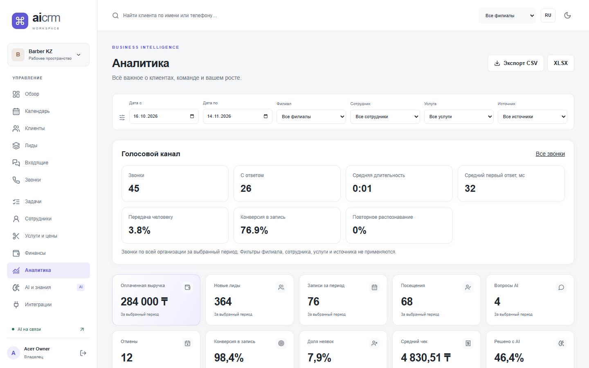
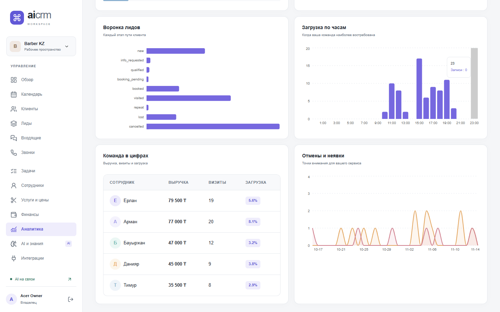

# 10. Аналитика и экспорт

1. Откройте **Аналитика**.
2. Выберите период, филиал, сотрудника, услугу и источник. Для общего отчёта оставьте варианты «Все…».
3. Прочитайте показатели по [правилам обзора](02-dashboard.md). Здесь **Записи за период** относятся к выбранным датам.
4. Прокрутите ниже: дополнительные карточки показывают **Завершено без оплаты**, **Конверсия в визит** и **Возвраты**.
5. Владелец и аналитик могут нажать **Экспорт CSV** или **XLSX**. Браузер скачает файл отчёта с выбранными фильтрами.

**Конверсия в визит** — доля записей, дошедших до статуса «клиент пришёл» или «завершена», среди записей за период. Визиты без записи в числитель этой конверсии не добавляются.

> Блок **Голосовой канал** показывает звонки всей организации за выбранные даты. Фильтры филиала, сотрудника, услуги и источника к нему не применяются. Не сравнивайте его напрямую с отфильтрованными данными одного мастера.

Даты учитываются в часовом поясе филиала, указанном внизу страницы. Если нет данных, сначала проверьте период и фильтры. У администратора нет кнопок экспорта и доступа к реальным денежным суммам.

[К содержанию](README.md)
