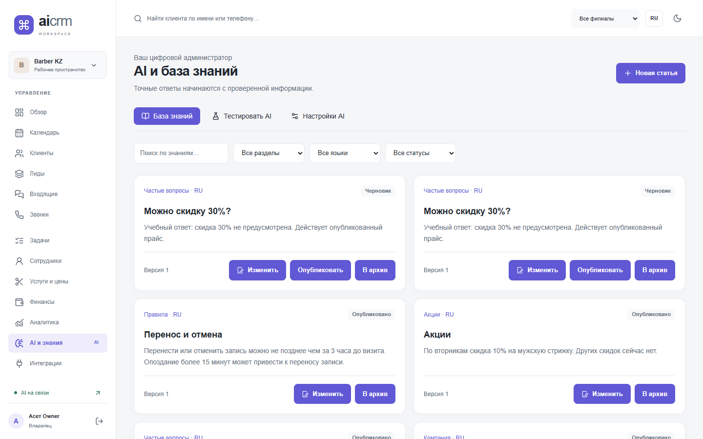
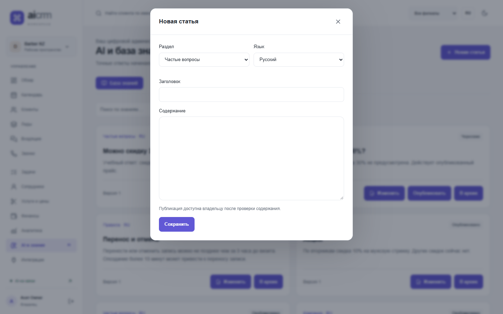
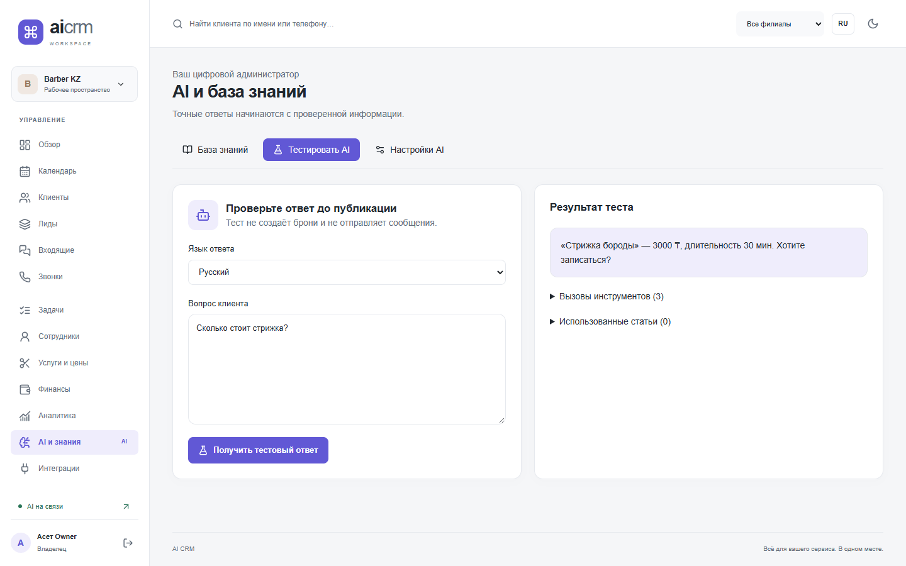
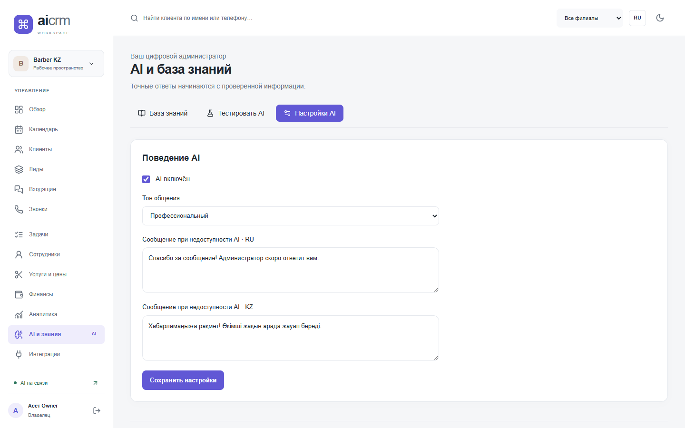

# AI и база знаний

[← Содержание](README.md)

## Подготовить и опубликовать статью

1. Откройте **AI и база знаний → База знаний**.
2. Нажмите **Новая статья**.
3. Выберите раздел и язык **Русский** или **Қазақша**. Заполните заголовок и содержание.
4. Нажмите **Сохранить**: статья появится как **Черновик**.
5. Проверьте текст и тестовый ответ. Владелец нажимает **Опубликовать** и подтверждает действие.

Поиск и фильтры помогают найти статью по разделу, языку и статусу. Для двух языков создавайте отдельные статьи с проверенным содержанием.

> **Важно:** обычные ответы AI используют опубликованные знания. При изменении содержания опубликованной статьи она снова становится черновиком, а версия увеличивается. После проверки нужна повторная публикация.

Кнопка **В архив** выводит устаревшую статью из использования. Архивную статью нельзя редактировать: для нового материала создайте новую статью.

## Проверить ответ до публикации

1. Перейдите на вкладку **Тестировать AI**.
2. Выберите язык ответа и введите вопрос клиента.
3. Нажмите **Получить тестовый ответ**.
4. Прочитайте ответ. При необходимости раскройте **Использованные статьи**, чтобы проверить источники, и **Вызовы инструментов**, чтобы понять действия AI.
5. Исправьте знания и повторите проверку, затем опубликуйте готовую статью.

> **Важно:** этот тест учитывает черновики, но не создаёт записи, задачи или переписку и не отправляет сообщения клиентам. Успешный тест черновика не заменяет публикацию.

## Настройки и экстренное отключение

Пользователь с правом изменения настроек видит вкладку **Настройки AI**. Здесь доступны флажок **AI включён**, тон общения и тексты при недоступности AI на RU/KZ. После изменения нажмите **Сохранить настройки**.

Если AI отвечает неправильно:

1. В конкретной переписке нажмите **Взять диалог**, подтвердите и ответьте клиенту.
2. Для остановки автоматических ответов снимите **AI включён** и сохраните настройки.
3. Проверьте ошибочные знания, исправьте и протестируйте их.
4. Включайте AI после проверки; нужный диалог возвращайте AI отдельной кнопкой.

> **Важно:** выключение AI также прекращает автоматическую обработку голосовым AI; телефонный канал при этом не отключается. Отдельный флажок голосового AI находится в [настройках телефонии](12-integrations-settings.md). После изменения проверьте входящие и задачи, чтобы клиент не остался без ответа.
