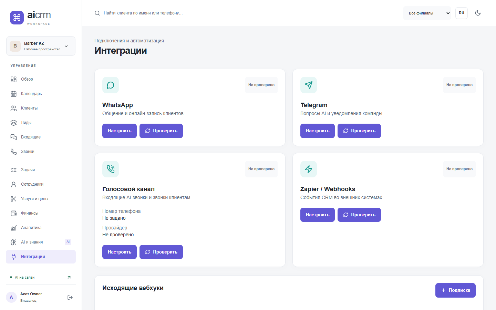
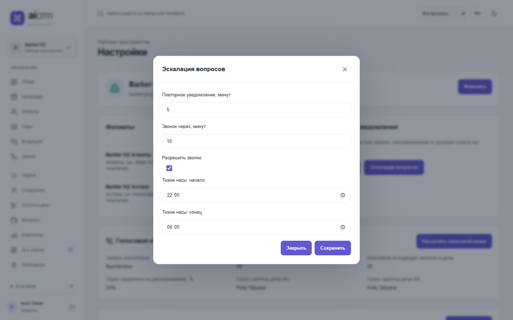
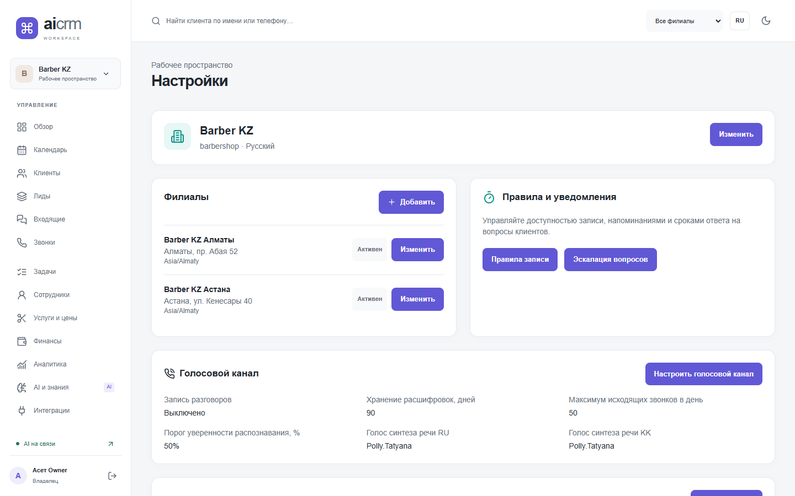
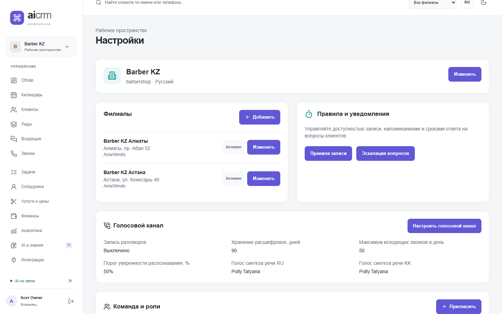
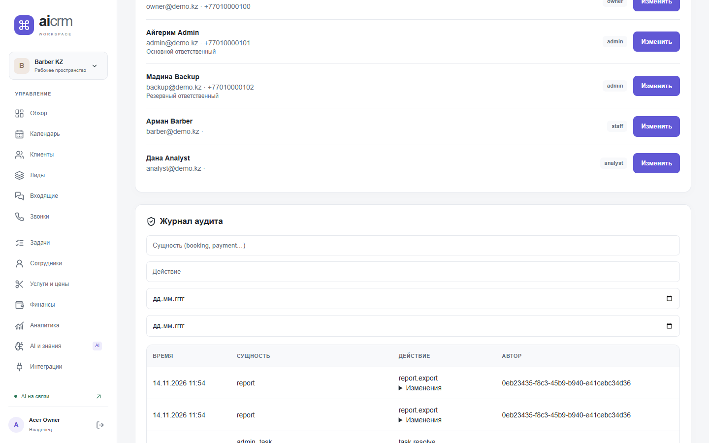

# 12. Интеграции и настройки

## Проверить подключение

1. Откройте **Интеграции**. Раздел видят владелец и администратор.
2. Найдите WhatsApp, Telegram, голосовой канал или Zapier / Webhooks.
3. Прочитайте статус: **Подключено**, **Активно**, **Работает**, **Отключено**, **Не проверено** либо **Ошибка**. При ошибке посмотрите пояснение под карточкой.
4. Внизу откройте **Журнал событий** и выберите **Ошибки**, **Доставлено** или **Ожидание**, чтобы проверить конкретное событие.

Владелец может нажать **Проверить** и прочитать ответ сервера. Для неудавшихся событий доступно **Повторить** с подтверждением. Зелёная карточка подключения сама по себе не подтверждает доставку конкретного сообщения: проверьте его статус в чате или журнале.

> Подключение и секреты настраивает технический специалист по документу `docs/ONBOARDING_BUSINESS.md`, который сопровождает техническая команда. Для сообщения об ошибке передайте название канала, время и текст ошибки. Не пересылайте токены, пароли или содержимое секретных полей.

## Правила записи и уведомления — владелец

1. Откройте **Настройки** → **Правила записи**.
2. Проверьте шаг слота, срок удержания времени и срок отмены до визита.
3. Укажите напоминания в часах через запятую, например `24, 2`; при необходимости включите подтверждение администратора.
4. Нажмите **Сохранить**.
5. В **Эскалация вопросов** настройте повторное уведомление, звонок, разрешение звонков и тихие часы. В форме по умолчанию предложены 5 и 10 минут; рабочие значения определяются сохранёнными настройками организации.

Здесь же доступны название и язык организации, филиалы и их часовой пояс. Язык организации и личный переключатель RU/KZ в верхней панели выполняют разные задачи: первый задаёт язык по умолчанию, второй меняет интерфейс текущего пользователя.

## Команда и роли — владелец

1. Прокрутите до **Команда и роли**.
2. Нажмите **Пригласить**, заполните email, имя, роль и временный пароль не короче восьми символов.
3. Для эскалаций укажите контактные данные и отметьте основного или резервного ответственного.
4. Сохраните. Для существующего участника используйте **Изменить**.

> Кнопка **Пригласить** создаёт участника с временным паролем. Не рассчитывайте на автоматическую отправку письма: передайте доступ согласованным защищённым способом.

## Журнал аудита — владелец

1. Внизу **Настроек** найдите **Журнал аудита**.
2. Укажите сущность, например `booking` или `payment`, действие и даты. Пустые поля снимают соответствующий фильтр.
3. Сверьте время, сущность, действие и автора. При наличии раскрывайте **Изменения** для подробностей.

Журнал помогает установить, кто изменил запись или оплату; исправление выполняйте в исходном разделе. Настройки голосового канала и хранения расшифровок описаны в [разделе о звонках](07-calls.md).

[К содержанию](README.md)
