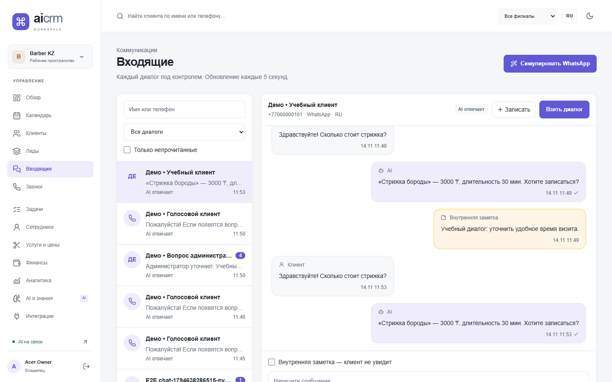

# 13. Частые вопросы администратора

## Клиент пишет, а AI молчит

1. В **Входящих** откройте нужный диалог и проверьте режим.
2. **Человек отвечает**: диалог передан сотруднику; ответьте самостоятельно или нажмите **Вернуть AI** и подтвердите.
3. **Ждём админа**: проверьте **Задачи**, возьмите вопрос и дайте проверенный ответ.
4. Если указан **AI отвечает**, проверьте ошибку доставки в сообщениях и статус канала в **Интеграциях**. При необходимости возьмите диалог на себя и передайте владельцу время и описание сбоя.

> Надпись «AI отвечает» обозначает режим диалога, а не гарантию уже отправленного ответа. Проверяйте сообщения и их статусы доставки.

## Почему не пришло уведомление?

1. Проверьте, появилась ли задача в **Задачах**. У уже взятой задачи эскалация останавливается.
2. Уточните у владельца основного/резервного ответственного и его контакты в **Настройках**.
3. Для звонка проверьте разрешение звонков, таймеры и тихие часы. Для Telegram — состояние интеграции.
4. Посмотрите ошибки в **Интеграциях** → **Журнал событий**. Проверку подключения и повторную отправку выполняет владелец.

## Как отменить запись без штрафа?

1. Откройте запись в **Календаре** и согласуйте отмену с клиентом.
2. Введите **Причина отмены**, нажмите **Отменить запись** и подтвердите.
3. Если была предоплата, отдельно согласуйте и проведите возврат: отмена записи не равна возврату денег.

В панели нет отдельной команды «отменить без штрафа» и автоматического расчёта штрафа. Срок отмены ограничивает действия клиента/AI; администратор помогает с исключениями по правилам бизнеса. Не обещайте возврат, пока он не оформлен.

## Что делать, если AI ошибся?

1. Нажмите **Взять диалог** и подтвердите, затем отправьте клиенту корректный ответ.
2. Оставьте внутреннюю заметку для команды, если важно сохранить контекст.
3. Проверьте соответствующий материал в **AI и знания**. Исправьте черновик, а владельца попросите проверить и опубликовать изменение.
4. Протестируйте ответ и только после проверки верните диалог AI. При массовой проблеме попросите владельца отключить AI в его настройках.

## Почему в отчёте администратора 0 ₸?

У администратора нет доступа к денежным показателям отчёта. Скрытая сервером сумма в текущей панели может отображаться нулём. Для финансовой сверки нужен владелец или аналитик.

## Почему запись не создаётся на выбранное время?

Проверьте филиал, график мастера, длительность услуг, перерывы и уже занятые слоты. Выберите предложенную альтернативу. Сообщать клиенту подтверждение можно после успешного сохранения записи.

[К содержанию](README.md)
