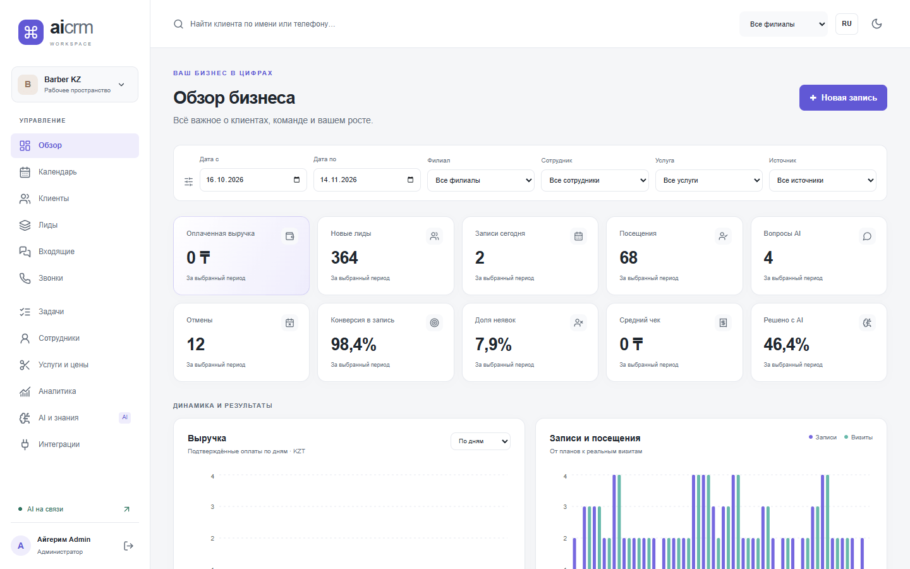
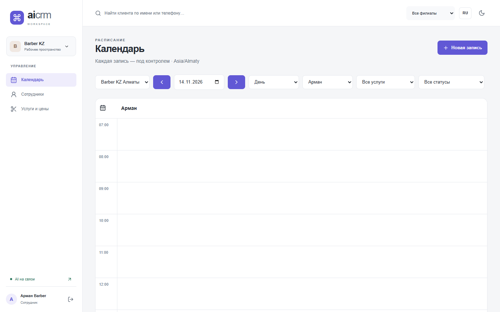
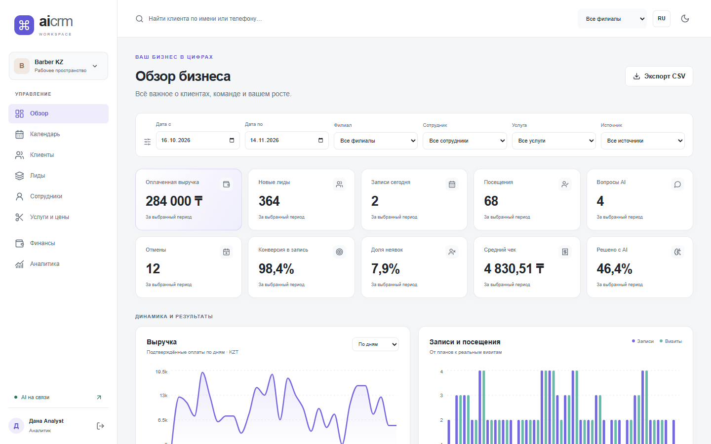
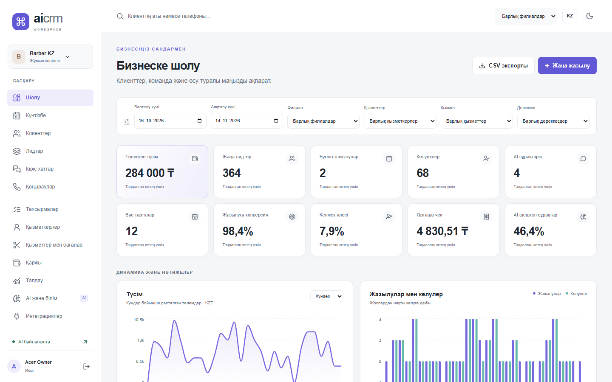
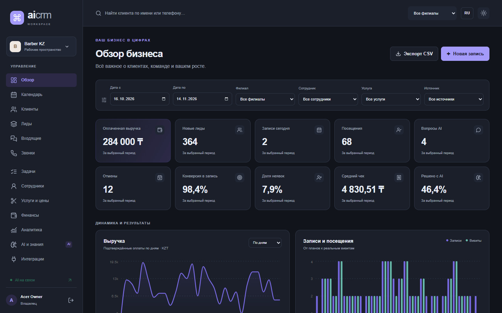
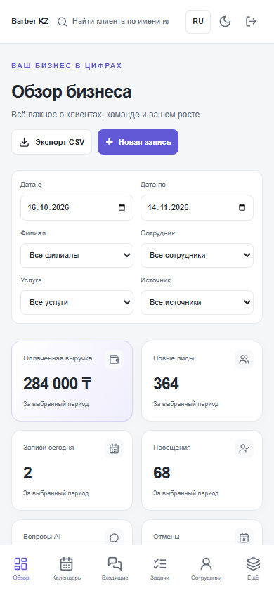

# Руководство пользователя AI CRM — v1.0

Практическое руководство на русском языке для владельца, администратора, мастера и аналитика. Примеры относятся к демонстрационной организации **Barber KZ**. Имена, номера и переписка на учебных экранах вымышлены. [Қазақша қысқаша жадынама](kz-summary.md).

## Содержание

1. [Начало работы: вход, организация, язык, тема, роли и телефон](01-start.md)
2. [Обзор бизнеса: показатели, формулы и графики](02-dashboard.md)
3. [Календарь: запись, перенос, отмена, статусы и оплата](03-calendar.md)
4. [Клиенты и лиды: карточка, согласия, дубли и воронка](04-clients-leads.md)
5. [Входящие и AI: режимы диалога, перехват, заметки и симулятор](05-inbox-ai.md)
6. [Задачи и эскалация: принятие вопроса и проверенный ответ](06-tasks-escalation.md)
7. [Звонки: голосовой AI, расшифровки и согласия](07-calls.md)
8. [Сотрудники: графики, исключения и заявки мастеров](08-staff.md)
9. [Услуги и финансы: цены RU/KZ, оплаты и возвраты](09-services-finance.md)
10. [Аналитика: фильтры и экспорт CSV/XLSX](10-analytics.md)
11. [AI и знания: черновики, публикация, тестирование и отключение](11-ai-knowledge.md)
12. [Интеграции и настройки: статусы, правила, команда и аудит](12-integrations-settings.md)
13. [Частые вопросы администратора](13-faq.md)
14. [Қазақша қысқаша жадынама](kz-summary.md)

> AI не должен подтверждать запись, пока она не создана в системе. После записи, переноса, отмены или оплаты дождитесь ответа сервера и проверьте результат на экране.

## Интерфейс разных ролей

Состав меню и доступные действия зависят от роли. Начните с [таблицы ролей](01-start.md), если нужной кнопки нет.

Владелец:


Администратор:



Мастер:



Аналитик:



Казахский интерфейс и тёмная тема:





Мобильный интерфейс:



## Границы проверки

Снимки создаются из работающего интерфейса с настоящими ответами локального API. Учебные диалоги и звонки создаются средствами демонстрационной среды; реальные сообщения клиентам и реальные телефонные звонки для руководства не отправляются.

Telegram-кнопки и логика таймеров сверены с реализацией. Фактическая доставка во внешнюю сеть Telegram и телефонный дозвон в демосреде не подтверждены: они зависят от подключённого провайдера, контактных данных и рабочих настроек. Указанные в руководстве ограничения интерфейса нельзя считать обещанием отсутствующей функции.

## Повторно создать снимки

Нужны работающие контейнеры панели `http://localhost:3000` и API `http://localhost:8000`, Node.js 24, установленный Google Chrome и существующие зависимости `frontend/node_modules`. Для сжатия используется `sharp`, уже установленный вместе с Next.js.

Из корня проекта:

```powershell
cd frontend
npm run guide:screenshots
```

Скрипт [`user-guide-screenshots.ts`](../../frontend/scripts/user-guide-screenshots.ts) входит через форму под четырьмя учебными аккаунтами: `owner@demo.kz`, `admin@demo.kz`, `barber@demo.kz`, `analyst@demo.kz`. Демопароль — `demo12345`; переопределение доступно через переменную `GUIDE_DEMO_PASSWORD`. Запускайте только на локальном демостенде: сценарий создаёт учебные данные и выполняет показанные действия.

Результат сохраняется в `img/`: страницы ролей имеют имена `owner-<страница>.png`, `admin-<страница>.png`, `barber-<страница>.png`, `analyst-<страница>.png`; отдельные действия и диалоги — тематические имена. Размеры кадров: **1440 × 900** и несколько мобильных **390 × 844**. PNG сжимаются до **300 КБ** на файл. Пароли остаются скрытыми, секретные настройки не раскрываются.

Файл [verification.json](verification.json) содержит результаты обхода страниц и взаимодействий, имена снимков, размеры и параметры кадров. Он помогает сверить руководство после изменения интерфейса.

Проверка ссылок, размеров PNG и сборка HTML для просмотра:

```powershell
python docs/user-guide/verify.py
```

Команда выполняется из корня проекта и требует `markdown-it-py` и Pillow. [HTML для просмотра](preview.html) и [результат проверки](validation.json) хранятся рядом с руководством.
