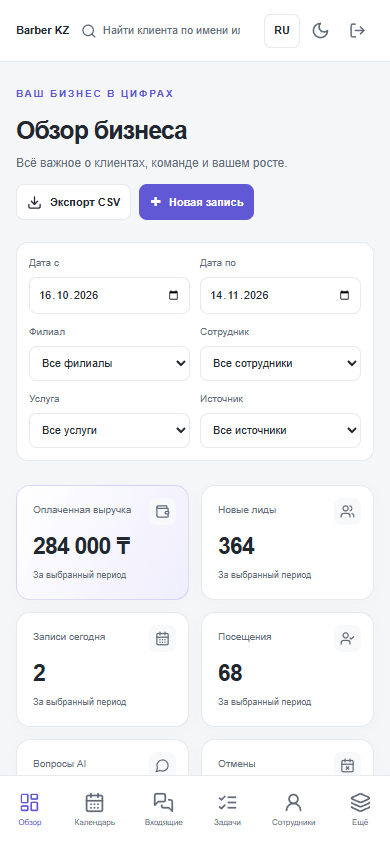
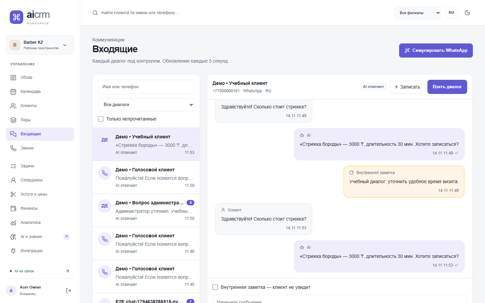

# Әкімшіге арналған қысқаша жадынама

## Жұмысты бастау

1. [CRM панелін](http://localhost:3000) ашып, жұмыс email-іңіз бен құпиясөзіңізді енгізіңіз.
2. Ұйым атауын және филиалды тексеріңіз. Бірнеше ұйымға қолжетімділік болса, ұйымды тізімнен таңдаңыз.
3. Жоғарғы жақтағы **RU/KZ** түймесімен тілді ауыстырыңыз. Телефонда бөлімдерді төменгі мәзірден немесе **Тағы** арқылы ашыңыз.

## Клиентті жазу

1. Күнтізбені ашып, жаңа жазылуды бастаңыз.
2. Клиентті, филиалды, қызметті, маманды және уақытты таңдаңыз.
3. Уақыт бос болмаса, басқа ұсынылған уақытты таңдаңыз.
4. Сақтап, жазылудың күнтізбеде пайда болғанын тексеріңіз.

> Жазылу жүйеде жасалғаннан кейін ғана клиентке расталғанын айтыңыз. Бас тарту төлемді автоматты түрде қайтармайды.

## Диалог пен AI сұрақтары

1. Кіріс диалогын ашып, режимін тексеріңіз: **AI жауап беруде**, **Адам жауап беруде** немесе **Әкімшіні күтудеміз**.
2. Өзіңіз жауап беру үшін диалогты қабылдап, әрекетті растаңыз.
3. Командаға арналған мәліметті ішкі ескертпе ретінде жазыңыз: клиент оны көрмейді.
4. Мәселе шешілсе, диалогты AI-ға қайтарыңыз.
5. Тапсырмадағы сұрақты қабылдаңыз — бұл эскалацияны тоқтатады. Тексерілген жауапты енгізіп, клиентке жіберу және білім қорына жоба ретінде қосу белгілерін тексеріңіз.

## Клиент келді және төлем

Күнтізбедегі жазылуды ашып, клиент келгенін белгілеңіз; қызмет аяқталғанда тиісті күйге ауыстырыңыз. Төлемді жазылудан рәсімдеңіз. Ақшаны қайтару — бөлек операция. Клиенттің қоңырауға, жазбаға және хабарламаға берген келісімін тексеріңіз.

## Қате немесе хабарлама келмесе

Алдымен диалог күйін, тапсырмаларды және интеграциядағы қателерді тексеріңіз. AI қателессе, диалогты қабылдап, клиентке дұрыс жауап беріңіз; білім қорын түзету мен жариялауды иесімен келісіңіз. Құпиясөздер мен токендерді хабарламада жібермеңіз.

Әкімшіге қаржы есебінің сомалары мен экспорт қолжетімсіз. Толық қаржы есебін иесінен немесе талдаушыдан сұраңыз.

[Орыс тіліндегі толық нұсқа](README.md)
